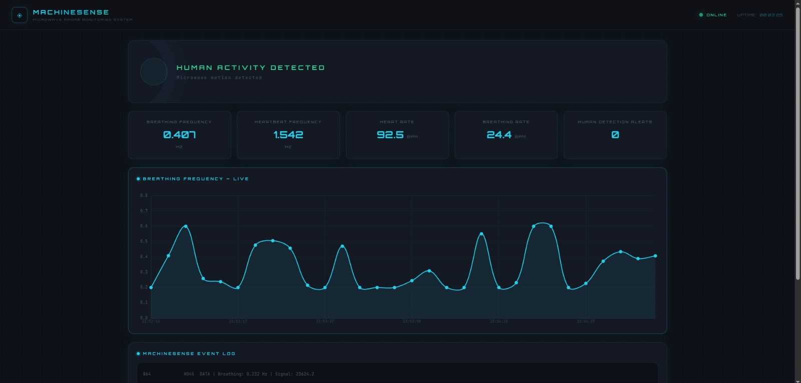
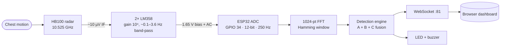
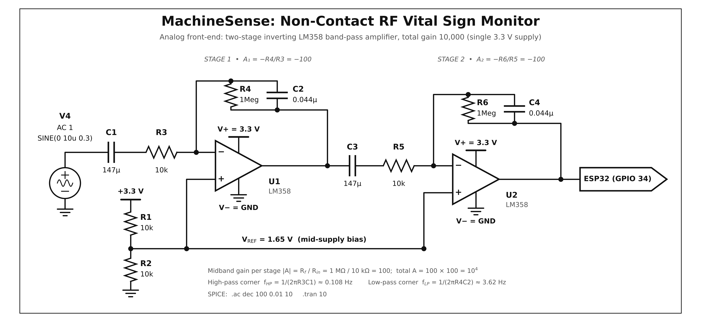
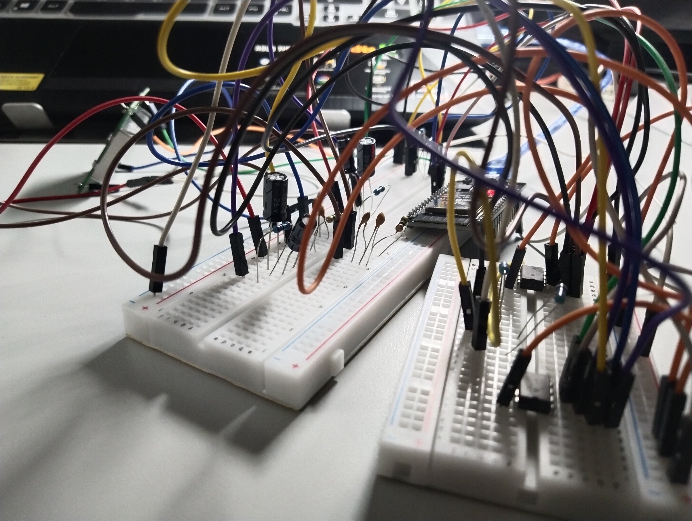
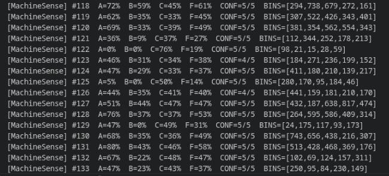

<div align="center">

# MachineSense: Contactless Radio-Frequency Doppler Radar System for Real-Time Breathing Rate Monitoring

### Non-contact RF vital-sign and presence monitor — HB100 Doppler radar + ESP32 + FreeRTOS

[](https://github.com/YOUR_GITHUB_USERNAME/MachineSense/actions/workflows/ci.yml)


</div>

MachineSense detects a person and estimates their **breathing rate without touching them**. A 10.525 GHz HB100
Doppler radar picks up chest motion as a microvolt-level IF signal; a two-stage LM358 amplifier boosts it 10,000×
and band-limits it; an ESP32 samples it at 250 Hz, runs a 1024-point FFT, fuses three detection methods, and streams
live telemetry over WebSockets to a browser dashboard.

> Built as the *Project Exhibition – I* project (B.Tech ECE, VIT Bhopal University, October 2026).
> Full write-up: [`docs/report/Project_Exhibition_1_Report_updated.pdf'.

> [!WARNING]
> MachineSense is an educational prototype. It is **not a medical device** and must not be used for diagnosis,
> patient monitoring, or any safety-critical decision.

<p align="center">
  
</p>

## Contents

- [Features](#features)
- [How it works](#how-it-works)
- [Hardware](#hardware)
- [Repository layout](#repository-layout)
- [Quick start](#quick-start)
- [Configuration](#configuration)
- [Detection algorithm](#detection-algorithm)
- [Results](#results)
- [Known limitations](#known-limitations)
- [Roadmap](#roadmap)
- [Authors](#authors)
- [Citing](#citing)

## Features

- **Contactless breathing-rate estimate** from the strongest FFT peak in the 0.2–0.6 Hz band (12–36 breaths/min), with parabolic sub-bin interpolation.
- **Human presence detection** from three fused methods (calibrated baseline, adaptive EMA floor, window-to-window change) with a 0–5 confidence counter and re-acquisition logic.
- **Experimental heartbeat-frequency readout** in the 1.0–2.5 Hz band (see [limitations](#known-limitations)).
- **Deterministic acquisition**: 250 Hz sampling via `vTaskDelayUntil` on a dedicated highest-priority FreeRTOS task.
- **Real-time web dashboard**: live chart, rate cards, alert counter, event log, calibration overlay, audible/visual alert — plain HTML/CSS/JS plus Chart.js, no build step.
- **Local alarm**: LED (GPIO 2) and buzzer (GPIO 25) pulse for 1.5 s on each new detection.
- **Self-calibrating**: learns the environmental noise floor at boot (3 FFT windows ≈ 12 s).
- **Always reachable**: joins your Wi-Fi (`machinesense.local`) or falls back to its own access point.

## How it works



| Stage | What happens |
|---|---|
| **RF** | A moving chest shifts the reflected frequency by *f<sub>d</sub> = 2·v·f<sub>t</sub> / c* (≈ 70.2 Hz per m/s at 10.525 GHz). Breathing at ~4 mm/s gives ~0.3 Hz. |
| **Analog** | Two inverting stages (A = −100 each) with AC coupling (high-pass ≈ 0.1 Hz) and RC feedback (low-pass ≈ 3.6 Hz), biased at 1.65 V so the single 3.3 V supply can swing both ways. |
| **Digital** | 1024 samples (4.096 s window, 0.244 Hz/bin) → DC removal → Hamming window → FFT → magnitude → band peaks + per-bin detection scores. |
| **Output** | Telemetry packet over WebSocket to the dashboard; local LED/buzzer on a new detection. |

More detail: [Architecture](docs/architecture.md) · [Hardware](docs/hardware.md) · [Signal processing](docs/signal-processing.md) · [WebSocket protocol](docs/protocol.md)

## Hardware

<p align="center">
  
</p>

| Part | Notes |
|---|---|
| ESP32 DevKit (ESP32-WROOM-32) | Dual core, Wi-Fi, 12-bit ADC |
| HB100 microwave motion sensor | 10.525 GHz, IF output to the amplifier |
| LM358 dual op-amp | One op-amp per stage, single 3.3 V supply |
| Resistors | 4 × 10 kΩ (R1, R2, R3, R5), 2 × 1 MΩ (R4, R6) |
| Capacitors | C1, C3 = 147 µF · C2, C4 = 0.044 µF (see [hardware notes](docs/hardware.md#component-values)) |
| Active buzzer, LED | Optional local alarm (GPIO 25 / GPIO 2) |

**Pin map**

| Signal | ESP32 pin |
|---|---|
| Amplifier output (ADC input) | GPIO 34 |
| Buzzer | GPIO 25 |
| Status LED | GPIO 2 (on-board LED on most dev kits) |

<details>
<summary>Breadboard prototype</summary>
<br>

</details>

## Repository layout

```
MachineSense/
├── firmware/                 PlatformIO project (ESP32, Arduino + FreeRTOS)
│   ├── platformio.ini
│   ├── include/              headers (+ secrets.h.example)
│   └── src/                  main, radar_sensor, signal_processing, detection, comms_ui
├── dashboard/                index.html · styles.css · app.js
├── docs/
│   ├── architecture.md  hardware.md  signal-processing.md  protocol.md
│   ├── images/               schematic, photos, screenshots
│   ├── schematic/            generate_schematic.py (reproduces the schematic)
│   └── report/               Project Exhibition – I report (PDF)
├── .github/                  CI workflow, issue and PR templates
├── CONTRIBUTING.md  CITATION.cff
```

## Quick start

### 1. Build the analog front-end
Assemble the circuit from the [schematic](docs/images/schematic.png) / [hardware guide](docs/hardware.md), connect the HB100 IF output to stage 1, and the stage-2 output to **GPIO 34**.

### 2. Flash the firmware
Install [PlatformIO](https://platformio.org/install), then:

```bash
git clone https://github.com/YOUR_GITHUB_USERNAME/MachineSense.git
cd MachineSense-Contactless-RF-Doppler-Radar-Breathing-Monitor/firmware

cp include/secrets.h.example include/secrets.h   # then edit: Wi-Fi SSID / password
pio run -t upload
pio device monitor                                # 115200 baud
```

`secrets.h` is git-ignored. Leave the SSID empty to use the built-in fallback access point instead.

### 3. Open the dashboard
Open `dashboard/index.html` in a browser (or serve the folder: `python3 -m http.server -d dashboard 8000`), enter the device address and click **Connect**:

| Mode | Address to enter |
|---|---|
| Joined your Wi-Fi | `machinesense.local` (or the IP printed on the serial monitor) |
| Fallback access point (`MachineSense-XXXX`) | the AP IP printed on the serial monitor (ESP32 default `192.168.4.1`) |

### 4. Calibrate
For the first ~12 s after boot the device learns the noise floor while the dashboard shows a calibration overlay. **Keep the area in front of the sensor clear and still** — anything present during calibration becomes part of the baseline and will make later detections weaker. Detection starts afterwards; a confirmed detection needs 5 consecutive above-threshold windows (≈ 20 s).

## Configuration

| What | Where |
|---|---|
| Wi-Fi SSID / password, AP password | `firmware/include/secrets.h` (or `build_flags`) |
| Sampling rate / FFT size / band bins | `firmware/src/radar_sensor.cpp`, `signal_processing.cpp`, `include/globals.h` |
| Fusion weights, thresholds, calibration length, EMA constants | top of `firmware/src/detection.cpp` |
| Serial debug output | `MACHINESENSE_DEBUG` in `detection.cpp` |
| Pins | `firmware/include/globals.h` |

## Detection algorithm

Each FFT window yields bin magnitudes for 0–3 Hz. Three scores in [0, 1] are fused:

| Method | Idea | Weight |
|---|---|---|
| **A** – spectral | Per-bin ratio against the baseline captured at calibration | 0.40 |
| **B** – adaptive floor | Per-bin ratio against a slow EMA floor (α = 0.01) | 0.35 |
| **C** – differential | Relative change against a fast EMA reference (α = 0.08) | 0.25 |

`F = 0.40·A + 0.35·B + 0.25·C`. If `F ≥ 0.20` confidence increases by 1, otherwise it decreases by 1. At **5/5** a human is declared and an alert fires on the rising edge; if confidence drops to 0 the detector releases and re-arms at 3. Full derivation and constants: [docs/signal-processing.md](docs/signal-processing.md).

## Results

The serial monitor logs scores A/B/C, fused score F, confidence and low-frequency bin magnitudes for every window; in the captured run confidence stayed at 4/5–5/5 with a person in range.

<p align="center">
  
</p>

> **Note:** the report (Table 3.1, Eq. 3.7) describes an earlier two-method fusion (`0.60·A + 0.40·C`, threshold 0.60). The firmware in this repository is the later three-method version above.

## Known limitations

- **Coarse spectral resolution.** A 4.096 s window gives 0.244 Hz per bin (≈ 14.6 breaths/min). Only two bins fall inside the breathing band, so interpolation matters and readings pinned at 0.200 Hz or 0.600 Hz mean the peak sits at the band edge.
- **Heartbeat is experimental.** The 1.0–2.5 Hz readout has not been validated against a reference sensor; breathing harmonics and body motion fall in the same band. Treat it as a diagnostic signal only.
- **Presence, not identity.** Detection responds to motion energy; it can be triggered by other moving objects and may miss a perfectly still person.
- **Single-channel receiver.** No I/Q, so range-dependent null points can reduce sensitivity at some distances.
- **LM358 on 3.3 V** is not rail-to-rail; see [hardware notes](docs/hardware.md#design-notes).
- **Dashboard needs internet** for Chart.js and Google Fonts (CDN). The WebSocket link is unauthenticated plain `ws://` — use it on a trusted LAN only.
- `detectionSemaphore` is given on each detection but nothing consumes it yet.

## Roadmap

- [ ] Overlapping FFT windows / zero-padding for faster, smoother updates
- [ ] Validate breathing and heart-rate readings against a reference sensor
- [ ] OLED status display (mentioned in the report objectives)
- [ ] Bluetooth / mobile app link
- [ ] Custom PCB for the analog front-end
- [ ] Vendor Chart.js and fonts for fully offline dashboard use

## Authors

| | |
|---|---|
| **Hemant Raj** (25BEC10093) | [@Hemant-Raj-1101](https://github.com/Hemant-Raj-1101) |
| **Harsh** (25BEC10054) | [@harsh0028-boop](https://github.com/harsh0028-boop) |

**Supervisor:** Dr. Rupesh Kumari, Assistant Professor, School of Electrical & Electronics Engineering, VIT Bhopal University.

## Citing

If you use this work, please cite it using [`CITATION.cff`](CITATION.cff) (GitHub's **Cite this repository** button).

