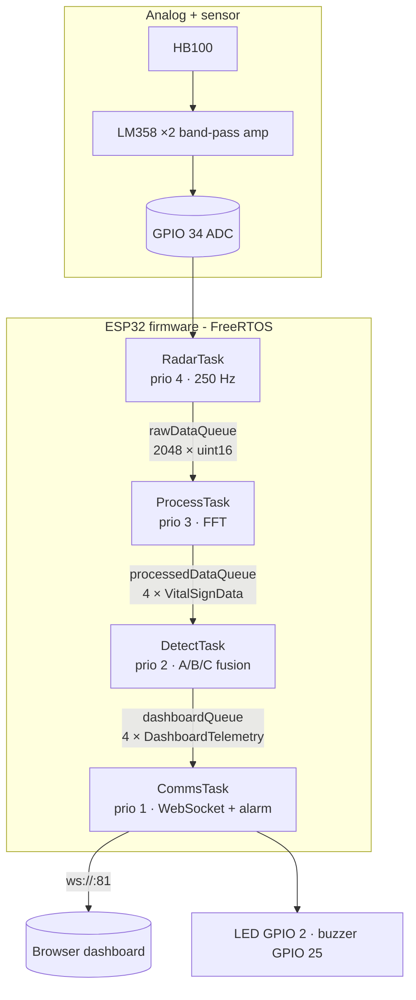

# Architecture

## Data flow

## Tasks

| Task | Source | Priority | Stack | Role |
|---|---|---:|---:|---|
| `vRadarAcquisitionTask` | `radar_sensor.cpp` | 4 | 2048 | `analogRead` every 4 ms using `vTaskDelayUntil`; pushes to `rawDataQueue` with zero timeout (drops a sample rather than miss the deadline). |
| `vSignalProcessingTask` | `signal_processing.cpp` | 3 | 8192 | Collects 1024 samples, removes DC, applies Hamming window, runs the FFT, extracts breathing/heartbeat peaks and 13 low-frequency bins. |
| `vDetectionTask` | `detection.cpp` | 2 | 6144 | Runs calibration then the three-method detector; builds `DashboardTelemetry`; detects the rising edge for alerts. |
| `vCommsUITask` | `comms_ui.cpp` | 1 | 8192 | Services the WebSocket server, broadcasts telemetry, drives the LED/buzzer for 1.5 s per alert. |

`setup()` (in `main.cpp`) creates the queues, calls `initCommsWiFi()` (blocking, ≤ 20 s for the router, then falls back to AP mode), starts the four tasks, and `loop()` deletes itself.

## Queues and shared state

| Object | Type | Producer → consumer |
|---|---|---|
| `rawDataQueue` | 2048 × `uint16_t` | Radar → Processing |
| `processedDataQueue` | 4 × `VitalSignData` | Processing → Detection |
| `dashboardQueue` | 4 × `DashboardTelemetry` | Detection → Comms |
| `detectionSemaphore` | binary semaphore | Given by Detection on each new detection (no consumer yet) |
| `systemState` | `volatile SystemState` | Written by Detection, read by Comms |

All inter-task sends use a zero timeout so a slow consumer can never stall an upstream task.

## Timing

- Sample period 4 ms (250 Hz); 1024 samples per window = **4.096 s** per result.
- Windows do not overlap, so the dashboard updates roughly every 4 s.
- Calibration = 3 windows ≈ 12.3 s. The dashboard's countdown is a fixed 15 s display.
- First possible confirmed detection: 5 above-threshold windows after calibration ≈ 20.5 s.
