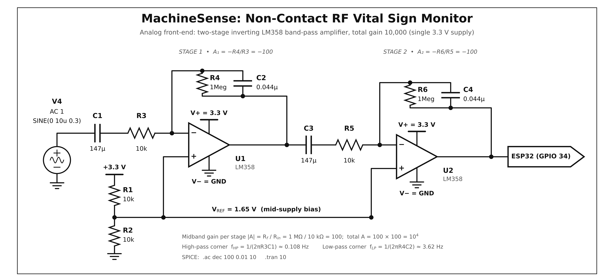

# Hardware

Vector versions: [`schematic.svg`](images/schematic.svg), [`schematic.pdf`](images/schematic.pdf). Regenerate with
`python3 docs/schematic/generate_schematic.py` (needs `matplotlib` and `numpy`).

In the schematic, **V4** is an AC test source standing in for the HB100 IF output during simulation
(`SINE(0 10u 0.3)` = 10 µV amplitude at 0.3 Hz, the typical breathing signal). Both op-amps are powered from
**3.3 V (V+) and GND (V−)**.

## Signal chain

| Block | Parts | Function |
|---|---|---|
| Input coupling | C1, R3 | Blocks the HB100's DC offset; forms the high-pass corner |
| Stage 1 | U1, R4 ‖ C2 | Inverting amplifier, A = −R4/R3 = −100, low-pass from R4·C2 |
| Inter-stage coupling | C3, R5 | Removes stage-1 DC; second high-pass |
| Stage 2 | U2, R6 ‖ C4 | Inverting amplifier, A = −R6/R5 = −100 |
| Bias | R1, R2 | 10 kΩ / 10 kΩ divider from 3.3 V gives VREF = 1.65 V on both (+) inputs |
| Output | — | Stage-2 output goes **directly** to ESP32 GPIO 34 (no output divider) |

Total gain 100 × 100 = **10,000**: a ~10 µV radar signal becomes ~100 mV AC riding on 1.65 V, well inside the
ADC's 0–3.3 V range (1 LSB ≈ 0.8 mV at 12 bits).

## Corner frequencies

Using the component values in the schematic:

| Corner | Formula | Value |
|---|---|---|
| High-pass (each stage) | 1 / (2π · 10 kΩ · 147 µF) | **0.108 Hz** |
| Low-pass (each stage) | 1 / (2π · 1 MΩ · 0.044 µF) | **3.62 Hz** |

The passband (≈ 0.1–3.6 Hz) covers breathing (~0.2–0.6 Hz) and the heartbeat range (~1–2.5 Hz) while rejecting DC drift and mains/RF noise.

### Component values

The report (Fig. 3.2 and §3.3) lists nominal **150 µF / 0.047 µF**, giving corners of 0.106 Hz and 3.39 Hz. The schematic
in this repository lists **147 µF / 0.044 µF**, giving 0.108 Hz and 3.62 Hz. The behaviour is essentially identical;
use whichever your actual parts provide and update the schematic script if you want the diagram to match.

## Bill of materials

| Ref | Value | Qty | Notes |
|---|---|---:|---|
| — | ESP32 DevKit (WROOM-32) | 1 | |
| — | HB100 Doppler module | 1 | Check your module's datasheet for supply (typically 5 V) and IF pin |
| U1, U2 | LM358 | 2 sections | One dual package provides both; the prototype photo shows two ICs |
| R1, R2, R3, R5 | 10 kΩ | 4 | |
| R4, R6 | 1 MΩ | 2 | |
| C1, C3 | 147 µF (≈ 150 µF) | 2 | Electrolytic; if polarised, put + toward the op-amp side of C1 |
| C2, C4 | 0.044 µF (≈ 47 nF) | 2 | Ceramic/film |
| — | Active buzzer, LED + resistor | 1 + 1 | Optional alarm |
| — | Breadboards, jumper wires | — | |

## ESP32 connections

| Signal | Pin | Direction |
|---|---|---|
| Stage-2 output | GPIO 34 (ADC1) | input |
| Buzzer | GPIO 25 | output |
| Status LED | GPIO 2 | output |
| Amplifier supply / bias | 3V3, GND | — |

GPIO 34 is on ADC1, which keeps working while Wi-Fi is active (ADC2 pins do not).

## Design notes

- **LM358 on 3.3 V.** The LM358 is not rail-to-rail: per its datasheet the input common-mode range tops out roughly 1.5 V below V+ and the output cannot reach V+. A 1.65 V bias sits close to that limit, so keep the output swing small (the design targets ~100 mV) and expect reduced headroom on a sagging supply. A rail-to-rail op-amp (e.g. MCP6002) is a drop-in improvement.
- **Gain split across two stages** avoids the instability and clipping risk of a single ×10,000 stage.
- **Layout.** Keep the HB100 IF lead short and away from the ESP32 antenna and switching loads; add 100 nF decoupling at each op-amp supply pin when moving off the breadboard.
- **Supply noise** couples directly into a 10⁴-gain chain. Power the analog section from a clean 3.3 V rail.
